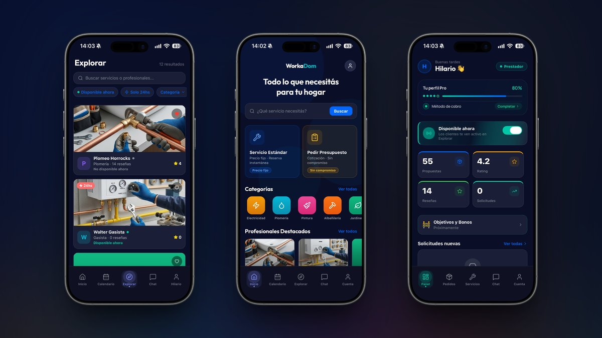
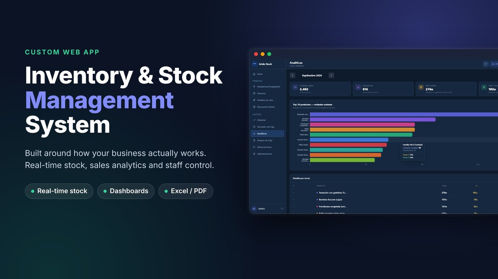
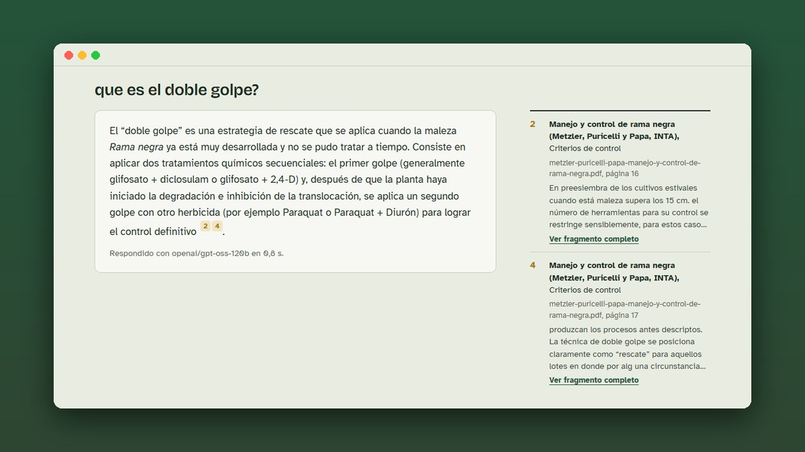
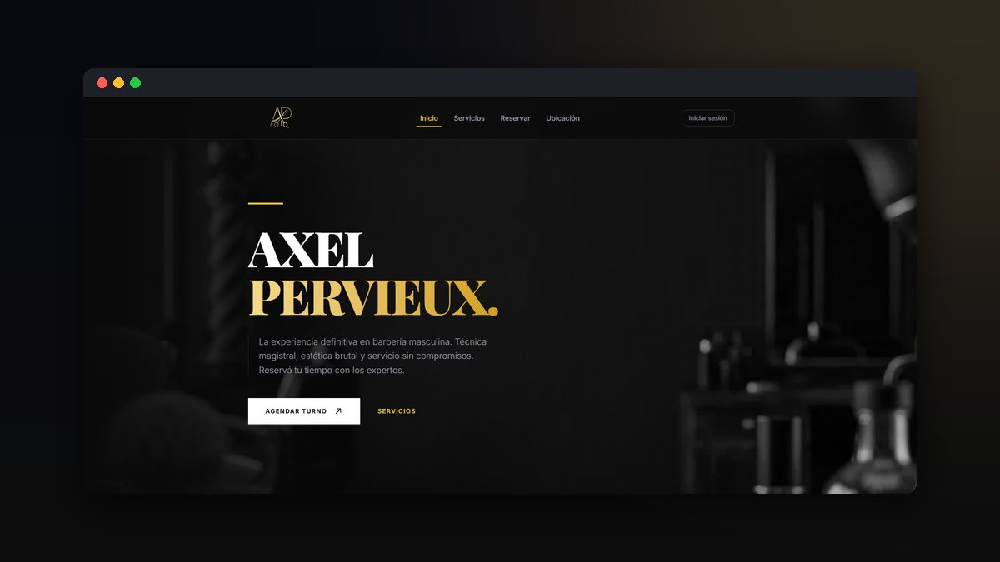

  

  

  
  

---

### Sobre mí

**Actualmente:** Co-founder & Full Stack Developer en Workadom  
**Enfoque:** IA aplicada (RAG, LLMs, tool calling)  
**Formación:** Desarrollador de Software (ITEC) · IA y Ciencia de Datos  
**Experiencia:** Backend con PHP en Picallex  
**Ubicación:** Río Cuarto, Argentina · Inglés avanzado

### Tecnologías

  

### Proyectos destacados

<table>
  <tr>
    <td width="50%" valign="top">
      
      <h4>Workadom</h4>
      App que conecta clientes con prestadores de servicios. Chat en tiempo real, notificaciones push y pagos split con Mercado Pago.
        
      
      
      
      
    </td>
    <td width="50%" valign="top">
      
      <h4>Stock Grido</h4>
      Gestión de stock para una franquicia de Grido, en producción. Asistente de IA, PWA instalable y alertas por Telegram.
        
      
      
      
      
    </td>
  </tr>
  <tr>
    <td width="50%" valign="top">
      
      <h4>Agro RAG</h4>
      Asistente agronómico con RAG sobre fichas de herbicidas y guías de control de malezas.
        
      
      
      
    </td>
    <td width="50%" valign="top">
      
      <h4>Turnos peluquería</h4>
      Reservas online con login por OTP, recordatorios automáticos, notificaciones push y por WhatsApp, y panel de administración.
        
      
      
      
      
    </td>
  </tr>
</table>

  

